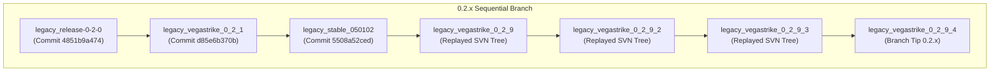
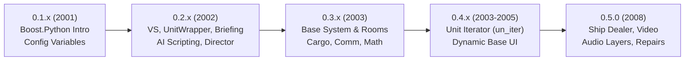

# Vega Strike Legacy History & Subversion Release Migration

## 1. Background & History

Vega Strike's codebase has a development history spanning over 26 years:
- **1999–2006**: Development began using **CVS** (Concurrent Versions System).
- **2006–2015**: The CVS repository was converted to **Subversion (SVN)** using `cvs2svn` (milestone tag `before_svn` on Jan 31, 2006). Subversion hosted `trunk`, `branches`, and `tags` under SourceForge.
- **2015**: Main engine development transitioned to **Git** on GitHub (`Vega-Strike-Engine-Source`), retaining the commit history.
- **Modern Era**: Releases from `0.6.0` through `0.10.x` and `0.11.x` were developed natively in Git with Git tags and release branches.

However, the Git repository historically lacked Git tags and historical release branches for earlier releases (0.1.x through 0.4.x and early 0.5.x). This document records the methodology, historical mappings, and tooling used to map Subversion release tags to Git commits and reconstruct sequential historical branches.

---

## 2. Monorepo vs. Engine Source Mapping

The Subversion repository (`vegastrike-code`) was structured as a monorepo containing multiple components:
- `trunk/vegastrike/`: The Vega Strike game engine and compilation toolchain.
- `trunk/data/` / `trunk/data4.x/`: Game assets and universe data (now in separate data repositories such as `Assets-Production`).
- `trunk/vssetup/`, `trunk/charserver/`, `trunk/masters/`, etc.

When the repository was migrated to Git for `Vega-Strike-Engine-Source`, only the `vegastrike/` engine directory was imported as the root of the Git repository.

Correspondingly, release tags in Subversion contain the engine source within `tags/<tag_name>/vegastrike/`.

```
Subversion Monorepo:
  ^/tags/vegastrike_0_4_3/vegastrike/  <=====>  Git Vega-Strike-Engine-Source root
  ^/tags/0.5.0/vegastrike/             <=====>  Git Vega-Strike-Engine-Source root
```

---

## 3. Commit Identification Methodology

Every Subversion release tag was analyzed to determine its origin:
1. **Copy-From History**: Each tag in SVN was created via `svn copy` from a specific revision $R_{src}$ of `trunk` (or a release branch).
2. **Metadata Correlation**: Commits imported into Git retain:
   - Identical commit log messages.
   - Identical authors (`hellcatv`, `alexannika`, `ace123`, `klaussfreire`, `nobody`).
   - Matching UTC author timestamps.
   - Author email addresses ending in `@9476613a-4e0a-0410-bcee-947800e9c4d1`, which is the Subversion repository UUID.
3. **Manufactured Tag Commits**: For the CVS era (up to Jan 31, 2006), `cvs2svn` created synthetic commits in the history explicitly labeled `This commit was manufactured by cvs2svn to create tag '<tag_name>'`. These commits exist directly along the trunk spine of `Vega-Strike-Engine-Source`.
4. **Tree Verification & Diff Isolation**:
   Comparing the Git trunk commits to the SVN `tags/<tag>/vegastrike/` trees revealed two categories:
   - **Clean Match**: The only differences are unexpanded vs. expanded RCS/SVN `$Id$` keywords, or autotools build artifacts (`Makefile`, `config.status`, `configure`) cleaned up in SVN.
   - **Tag-Specific Adjustments**: When a release was finalized in SVN, release engineers committed updates directly to the tag directory (e.g., packaging scripts, documentation, or backported fixes).

---

## 4. Sequential Release Branching Architecture (Option B)

To preserve the ability to inspect the release line sequentially while ensuring that every tag's tree is byte-for-byte identical to the SVN release, releases are organized into sequential release branches (`0.1.x`, `0.2.x`, `0.3.x`, `0.4.x`):



### Git Plumbing Tree Replay
Where an SVN tag contained release-specific modifications, Git plumbing (`git write-tree` and `git commit-tree`) was used to generate an exact Git tree from the Subversion tag and commit it into the branch with the original release manager's authorship, preserving repository integrity without mutating the active working directory.

---

## 5. Comprehensive Mapping Inventory

### Branch `0.1.x` (Early CVS Milestones & Tarballs)

| Milestone / Release | Date (UTC) | Git Commit | Tag Name | Notes |
| :--- | :--- | :--- | :--- | :--- |
| `betareleasecandidate102901` | 2001-10-29 | `b6dad1de16` | `legacy_betareleasecandidate102901` | cvs2svn manufactured tag commit (v0.0.9cvs) |
| `vegastrike-0.1.0` | 2001-11-07 | `5982d73d5f` | `legacy_vegastrike_0.1.0` | Matches SourceForge release date Nov 7, 2001 |
| `vegastrike-0.1.3` | 2002-01-15 | `11a75d15f7` | `legacy_vegastrike_0.1.3` | Berkeley personal page tarball release |
| `after_data_removal_stage1` | 2002-01-17 | `953a80b5e1` | `legacy_after_data_removal_stage1` | Legal data cleanup milestone |
| `vegastrike_snapshot_020117`| 2002-01-18 | `da2f1f573b` | `legacy_vegastrike_snapshot_020117` | Snapshot release listed in old download.html |

Branch `0.1.x` points to `da2f1f573b`.

---

### Branch `0.2.x` (Sequential 0.2 Release Line)

| Step | Release / Tag | Date (UTC) | Git Commit | Status | Tag Name |
| :---: | :--- | :--- | :--- | :---: | :--- |
| 1 | `release-0-2-0` | 2002-02-19 | `4851b9a474` | Clean trunk commit | `legacy_release-0-2-0` |
| 2 | `vegastrike_0_2_1` | 2002-03-11 | `d85e6b370b` | Clean trunk commit | `legacy_vegastrike_0_2_1` |
| 3 | `stable_050102` | 2002-05-01 | `5508a52ced` | Clean trunk commit | `legacy_stable_050102` |
| 4 | `vegastrike_0_2_9` | 2002-06-27 | `ce271b3b5d` | Replayed SVN tree | `legacy_vegastrike_0_2_9` |
| 5 | `vegastrike_0_2_9_2` | 2002-07-01 | `111b3c8527` | Replayed SVN tree | `legacy_vegastrike_0_2_9_2` |
| 6 | `vegastrike_0_2_9_3` | 2002-08-30 | `5eb68a509d` | Replayed SVN tree | `legacy_vegastrike_0_2_9_3` |
| 7 | `vegastrike_0_2_9_4` | 2002-08-30 | `eaf5c9592f` | Replayed SVN tree | `legacy_vegastrike_0_2_9_4` |

Branch `0.2.x` points to `eaf5c9592f`.

---

### Branch `0.3.x` (Sequential 0.3 Release Line)

| Step | Release / Tag | Date (UTC) | Git Commit | Status | Tag Name |
| :---: | :--- | :--- | :--- | :---: | :--- |
| 1 | `vegastrike_0_3_0` | 2003-01-07 | `7f3d3e9605` | Clean trunk commit | `legacy_vegastrike_0_3_0` |
| 2 | `vegastrike_0_3_1` | 2003-01-10 | `260d8683d3` | Clean trunk commit | `legacy_vegastrike_0_3_1` |
| 3 | `vegastrike_0_3_3` | 2003-01-24 | `00a86aae21` | Clean trunk commit | `legacy_vegastrike_0_3_3` |
| 4 | `vegastrike_0_3_9` | 2003-06-30 | `c2c64773a3` | Replayed SVN tree | `legacy_vegastrike_0_3_9` |

Branch `0.3.x` points to `c2c64773a3`.

---

### Branch `0.4.x` (Sequential 0.4 Release Line)

| Step | Release / Tag | Date (UTC) | Git Commit | Status | Tag Name |
| :---: | :--- | :--- | :--- | :---: | :--- |
| 1 | `vegastrike_0_4_0` | 2003-10-01 | `0de10fdd57` | Replayed SVN tree | `legacy_vegastrike_0_4_0` |
| 2 | `vegastrike_0_4_1` | 2003-10-24 | `71fae95642` | Replayed SVN tree | `legacy_vegastrike_0_4_1` |
| 3 | `vegastrike_0_4_2` | 2004-09-29 | `f2a5be9d69` | Replayed SVN tree | `legacy_vegastrike_0_4_2` |
| 4 | `vegastrike_0_4_3` | 2005-02-12 | `2dd156c29a` | Replayed SVN tree | `legacy_vegastrike_0_4_3` |

Branch `0.4.x` points to `2dd156c29a`.

---

### 0.5.x Series Legacy Tags

The existing `classic` and `0.5.x` branches continue to serve as the active bases. Legacy tags identify the SVN releases:

| SVN Tag | Date (UTC) | Git Commit | Tag Name | Description |
| :--- | :--- | :--- | :--- | :--- |
| `0.5.0` | 2008-05-08 | `485238e871` | `legacy_0.5.0` | Replayed final 0.5.0 SVN tree (including r12260) |
| `vegastrike_0_5_1_beta1` | 2011-03-09 | `0831baabb3` | `legacy_vegastrike_0_5_1_beta1` | Trunk commit "Tagging vegastrike 0.5.1.beta1 release" |
| `vegastrike_0_5_1_beta2` | 2012-01-30 | `4017c5bf98` | `legacy_vegastrike_0_5_1_beta2` | Trunk commit "Tagging 0.5.1.beta2 release" |
| `vegastrike_0_5_1_r1` | 2012-04-01 | `e24468df2f` | `legacy_vegastrike_0_5_1_r1` | Trunk commit "Tag 0.5.1.r1 release" |
| `0.5.2alpha-archive` | 2020-02-06 | `752c33e469` | `legacy_0.5.2alpha-archive` | Commit archiving code prior to GitHub migration |

*(Existing Git tags `0.5`, `0.5.1`, and `0.5.3` remain untouched).*

---

## 6. Migration Script Usage

The script [`script/migrate_legacy_svn_history.py`](file:///home/bmeyer/Devel/opensource/vegastrike/engine/Vega-Strike-Engine-Source/script/migrate_legacy_svn_history.py) automates the recreation and validation of these branches and tags.

### Prerequisites
A local checkout of the Subversion repository containing either the entire repository or the `tags/` directory:
```bash
# Full SVN repository checkout
svn checkout https://svn.code.sf.net/p/vegastrike/code /path/to/vegastrike-code

# Or checkout only the tags directory
svn checkout https://svn.code.sf.net/p/vegastrike/code/tags /path/to/vegastrike-code/tags
```

The script accepts `--svn-dir <path>` pointing either to the SVN root (containing `tags/`) or directly to the `tags/` folder. It also respects the `VEGA_SVN_DIR` environment variable and searches standard relative paths (`../vegastrike-code`, `../../research/vegastrike-code`).

### Dry Run (Validation Mode)
```bash
python3 script/migrate_legacy_svn_history.py --svn-dir /path/to/vegastrike-code
```

### Execution Mode
```bash
python3 script/migrate_legacy_svn_history.py --svn-dir /path/to/vegastrike-code --execute
```

---

## 7. Python Engine API Evolution (0.1.x – 0.5.0)

The game assets (missions, base interfaces, campaigns, dynamic universe logic, AI behaviors) interface with the engine through embedded Python modules. This section records the architectural evolution of the Python API from its introduction in late 2001 up through the `0.5.0` milestone.

For modern API revisions (0.6.x through 0.11.x / API Versions 1–3), see [doc/Engine-API.md](Engine-API.md).



### 7.1 Release Line Breakdown

#### Branch `0.1.x` (1999–early 2002): Introduction of Embedded Python
- **`legacy_vegastrike_0.1.0` (Nov 2001)**: Engine had no Python integration.
- **`legacy_vegastrike_0.1.3` (Jan 2002)**: Python first integrated on **November 12, 2001** via Boost.Python (`src/python/init.cpp`), exposing `config_xml` variables to allow scripts to query and manipulate engine settings.

#### Branch `0.2.x` (2002): Core Simulation & Unit Wrapper
- **`legacy_release-0-2-0` through `legacy_vegastrike_0_2_9`**: Development of initial AI scripting bridge (`pythonai.cpp`) and unit bindings.
- **`legacy_vegastrike_0_2_9_4` (Aug 2002 Milestone)**:
  - **`VS` Module**: Introduced with 48 universe, player, and mission functions (`getPlayer`, `launch`, `AdjustRelation`, `GetFactionIndex`, `GetFactionName`, `GetAdjacentSystem`, `SafeEntrancePoint`, `SetDifficulty`, `numActiveMissions`).
  - **`VS.Unit` Class**: First comprehensive `UnitWrapper` exposing 93 methods for navigation, shields, combat, docking, and flightgroup coordination (`AutoPilotTo`, `Position`, `GetVelocity`, `GetAngularVelocity`, `DealDamageToHull`, `Dock`, `UnDock`, `SetTurretAI`, `DisableTurretAI`, `LockMissile`, `FShieldData`, `BShieldData`, `rSize`, `isPlayerStarship`).
  - **`Director` Module**: Introduced with 7 persistence and execution functions (`Execute`, `Pickle`, `UnPickle`, `getSaveData`, `putSaveData`, `getSaveDataLength`, `pushSaveData`).
  - **`Briefing` Module**: Introduced with 10 cinematic camera and ship orchestration functions (`addShip`, `removeShip`, `enqueueOrder`, `replaceOrder`, `getShipPosition`, `setShipPosition`, `setCamPosition`, `setCamOrientation`, `setCloak`, `terminate`).

#### Branch `0.3.x` (2003): Base Screen System, Cargo & Steering
- **`legacy_vegastrike_0_3_0` (Jan 2003)**:
  - **`Base` Module**: Introduced with 17 functions, providing the foundation for 2D/3D station and planetary base screens (`Room`, `Link`, `Texture`, `Comp`, `Ship`, `Launch`, `Message`, `EnqueueMessage`, `Python`, `LaunchPython`, `CompPython`, `GetCurRoom`, `GetNumRoom`).
  - **`PythonAI` Class**: Expanded with 19 behavioral steering methods (`ChooseTarget`, `FaceTarget`, `FaceTargetITTS`, `MatchVelocity`, `MatchAngularVelocity`, `MoveTo`, `FormUp`, `XMLScript`, `LastPythonScript`).
  - **`VS` Math Helpers**: Exposes native trigonometric and mathematical functions directly into `VS` (`sin`, `cos`, `tan`, `asin`, `acos`, `atan`, `sqrt`, `exp`, `log`).
  - **`VS.Unit` Cargo & ECM**: Added cargo management (`addCargo`, `removeCargo`, `GetCargo`, `GetCargoIndex`, `hasCargo`, `incrementCargo`, `decrementCargo`), ship-to-ship communications (`communicateTo`, `commAnimation`), ECM controls (`getECM`, `setECM`), and interstellar jumping (`JumpTo`).
- **`legacy_vegastrike_0_3_9` (Jun 2003)**:
  - **`Director` String Persistence**: Added string-based save data storage (`pushSaveString`, `putSaveString`, `getSaveString`, `eraseSaveString`).
  - **Galaxy Properties & Factions**: Added `VS.GetGalaxyFaction`, `VS.SetGalaxyFaction`, `VS.GetGalaxyPropertyDefault`, `VS.TargetEachOther`, `VS.StopTargettingEachOther`.
  - **Targeting & Combat Geometry**: Added `Unit.ApplyDamage`, `Unit.GetOrientation`, `Unit.GetTarget`, `Unit.SetTarget`, `Unit.Kill`, `Unit.cosAngleTo`, `Unit.cosAngleToITTS`, `Unit.InsideCollideTree`.

#### Branch `0.4.x` (2003–2005): Iterators & Dynamic Base UI
- **`legacy_vegastrike_0_4_0` (Oct 2003)**:
  - **Unit Iterator (`VS.un_iter`)**: Introduced `UniverseUtil::PythonUnitIter` wrapping game universe units for iteration (`advance`, `current`, `isDone`, `next`, `preinsert`, `remove`).
- **`legacy_vegastrike_0_4_3` (Feb 2005)**:
  - **Dynamic Base UI**: Added text boxes, scripts, and room messaging: `Base.TextBox`, `Base.SetTextBoxText`, `Base.RunScript`, `Base.SetCurRoom`, `Base.MessageToRoom`, `Base.EnqueueMessageToRoom`.
  - **Combat Roles & Docking**: Added `Unit.forceAddCargo`, `Unit.removeWeapon`, `Unit.getCombatRole`, `Unit.isDockableUnit`.
  - **Sound & Stat Lookups**: Added `VS.StopAllSounds`, `VS.LookupUnitStat`, `VS.precacheUnit`, `VS.vsConfig`.

#### Release `0.5.0` (2008): Commercial Shipyards, Media & Maintenance
- **Ship Dealer & Custom Base Interfaces**: Added `Base.LoadBaseInterface`, `Base.BuyShip`, `Base.SellShip`, `Base.ExitGame`, `Base.GlobalKeyPython`, `Base.SetLinkArea`, `Base.SetLinkText`, `Base.SetLinkRoom`, `Base.SetLinkPython`, `Base.SetMouseEventData`.
- **Base Video Playback**: Introduced `Base.Video` and `Base.VideoStream` (video cutscenes in rooms).
- **Dynamic Multi-Track Music Layering**: Added layered soundtrack control in `VS` (`musicLayerPlayList`, `musicLayerPlaySong`, `musicLayerLoopList`, `musicLayerStop`, `musicLayerSkip`, `musicLayerSetSoftVolume`, `musicLayerSetHardVolume`).
- **Unit Maintenance & Damage Assessment**: Added `Unit.PercentOperational`, `Unit.MountPercentOperational`, `Unit.RepairCost`, `Unit.RepairUpgrade`, `Unit.RecomputeUnitUpgrades`.
- **Specialized Unit Iterators**: Added categorized iterator traversal methods to `VS.un_iter`: `advancePlanet`, `advanceJumppoint`, `advanceSignificant`, `advanceInsignificant` (along with step multipliers `advanceN*`).
- **Save Game Management**: Added `VS.saveGame`, `VS.loadGame`, `VS.getCurrentSaveGame`, `VS.getNewGameSaveName`, `VS.getSaveInfo`, `VS.getSaveDir`.
